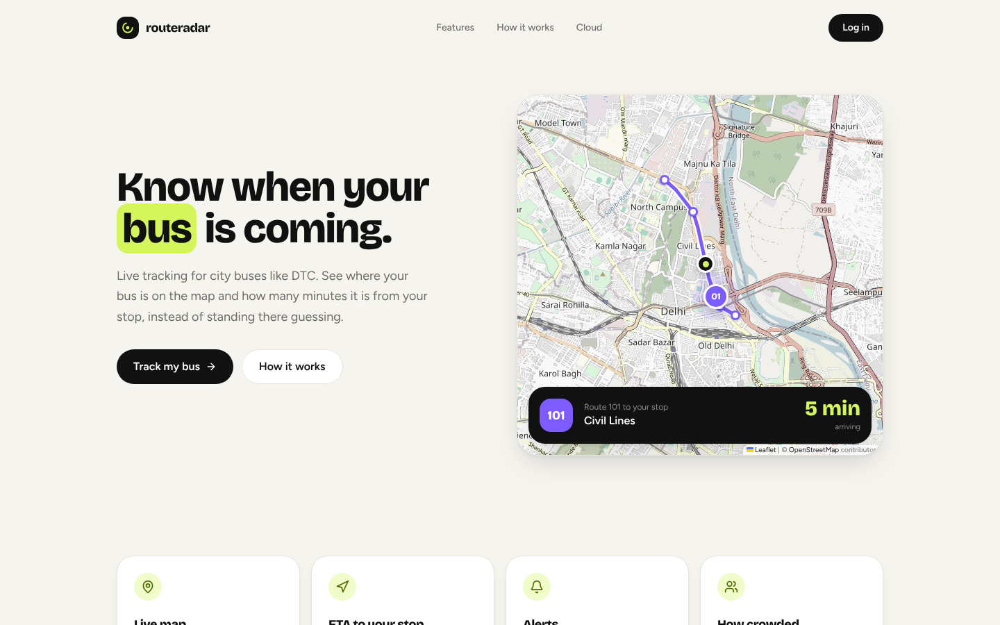
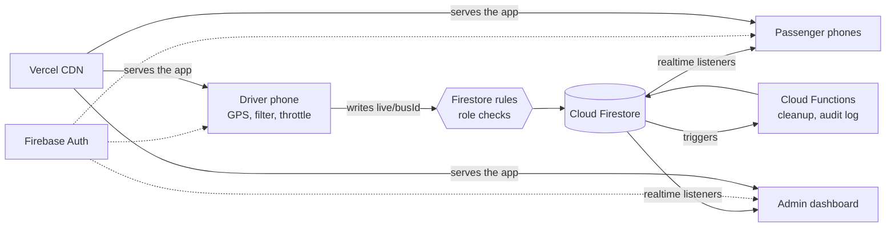
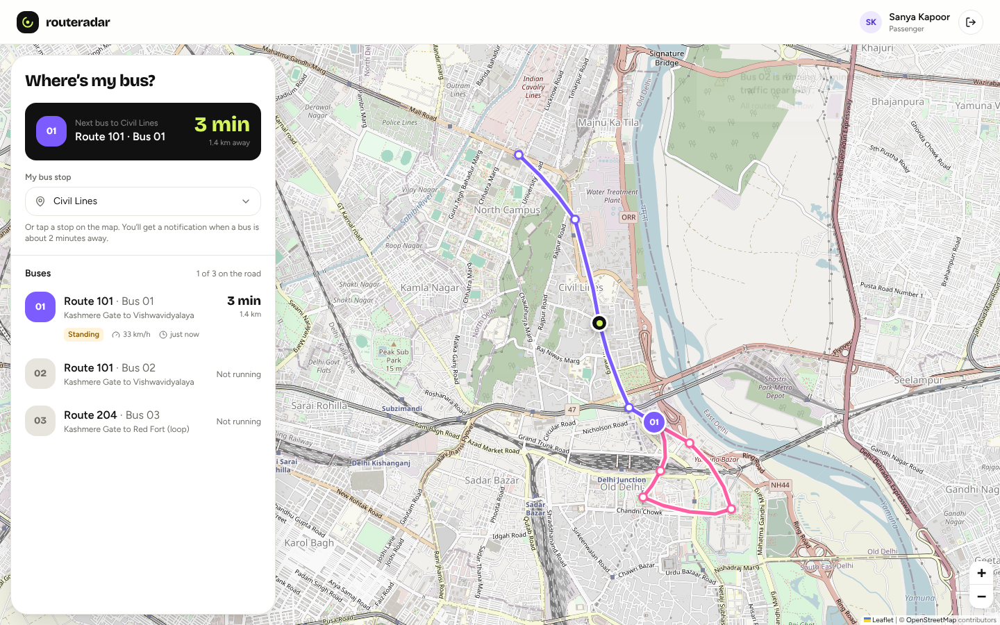
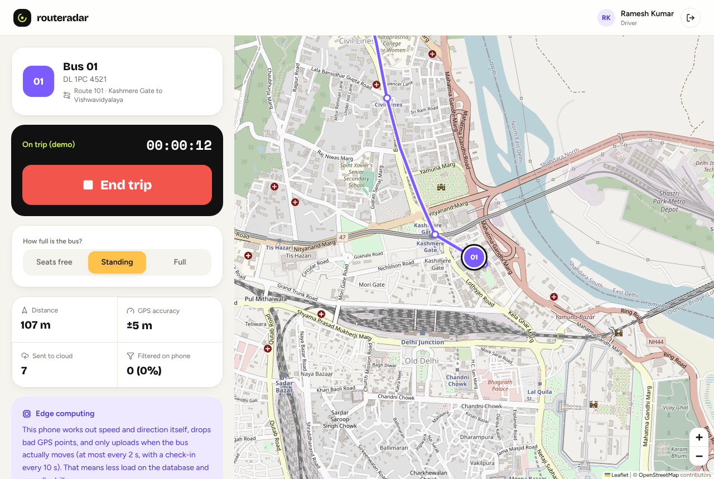
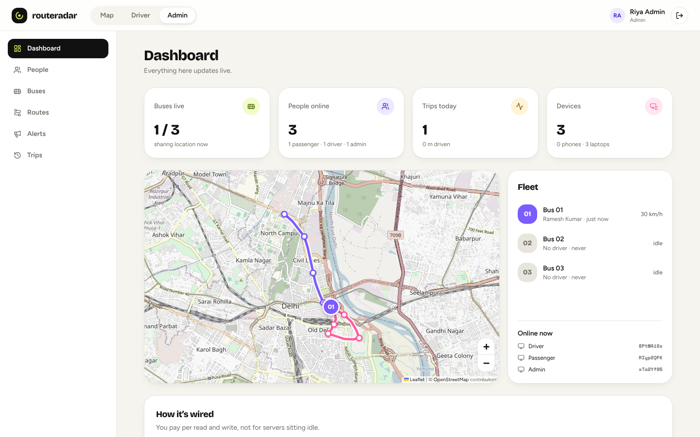
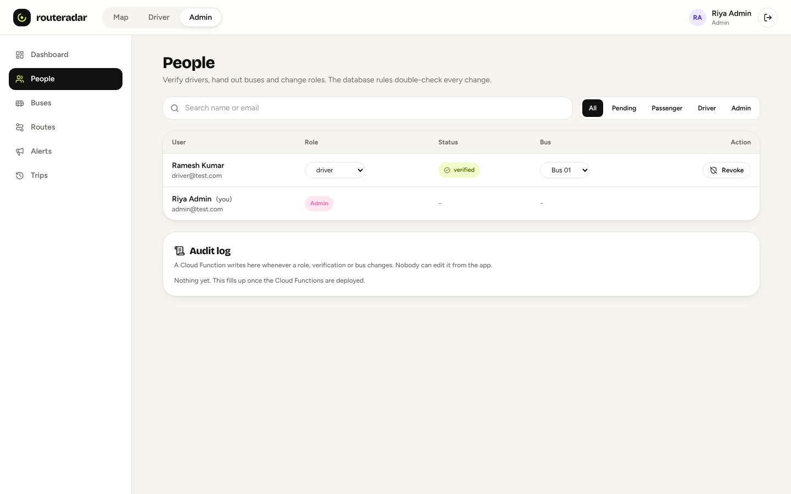
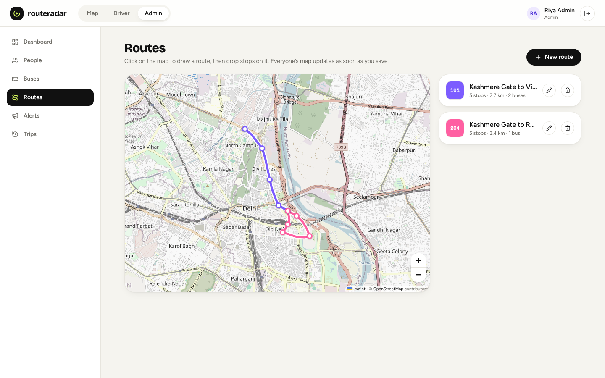
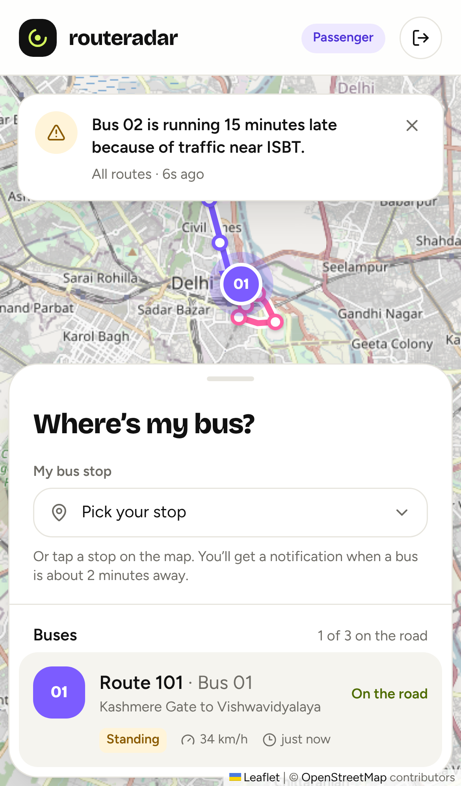

# routeradar

Live tracking for city buses like DTC. Passengers can see where their bus is on a map and how many minutes it is from their bus stop. The driver's phone is used as the GPS, so no extra hardware is needed on the bus.

Made for the Cloud Computing Systems and Applications (BCS 304) project. Domain: **transportation**.

Built with React (Vite + Tailwind), Leaflet with OpenStreetMap tiles, Firebase (Auth, Firestore, Cloud Functions) and Vercel.



## The problem

- People wait at bus stops for 15-30 minutes without knowing if their bus already passed, is stuck in traffic or isn't coming at all.
- Timetables at stops are rarely followed in city traffic, so they don't help much.
- Delays and breakdowns aren't announced anywhere passengers can see.
- The depot can't easily see where its buses are and has little trip data to plan with.

**Users:** daily passengers, bus drivers and depot staff (admin).

**Why the cloud:** a location from one moving phone has to reach thousands of passengers' phones within a second, all day, every day. Running our own servers for that would be expensive and hard to keep up. Firebase provides a realtime database, login and serverless functions; Vercel hosts the site; and we only pay for what we use.

## Objectives

1. Show every running bus on a live map, updated in under a second without refreshing.
2. Show an ETA to the passenger's own stop and alert them when the bus is about 2 minutes away.
3. Let a driver start sharing location with one tap, from their phone.
4. Give passengers, drivers and admins different permissions, checked on the server. A driver can't go live until an admin verifies them.
5. Give the admin a dashboard to manage buses, routes and drivers, send alerts, and see trip history.
6. Deploy it publicly, with high availability and no servers to look after.

## Features

**Passenger**
- live map with all buses (markers move smoothly between updates)
- pick "my stop" and see ETA + distance along the route
- alert when the bus is ~2 min away (in-app popup, browser notification, vibration)
- delay / breakdown alerts from the admin
- seat status (seats free / standing / full), speed, last update time
- "lost signal" if a bus stops sending

**Driver**
- start / end trip button
- GPS is cleaned up on the phone before uploading (see edge computing below)
- set how full the bus is
- demo mode that fakes a drive along the route (for presenting indoors)
- screen stays on during a trip

**Admin**
- dashboard: buses live, people online, trips today, live map
- verify drivers, assign buses, change roles
- add / remove buses
- draw routes and stops by clicking on the map
- send alerts to everyone
- trip log and audit log
- one button to load two sample routes from Kashmere Gate

## Architecture



### Firestore collections

| collection | what's in it | who can write |
|---|---|---|
| `users` | name, email, role, approved, busId, homeStop | user at sign-up (limited), admin |
| `routes` | name, colour, path points, stops | admin |
| `buses` | number, plate, route, driver, seats | admin |
| `live` | lat, lng, speed, heading, seat status, active | the verified driver of that bus |
| `trips` | bus, driver, start/end time, distance | driver, cloud function |
| `alerts` | message, type, route, active | admin |
| `presence` | last seen (for the online count) | each user, own doc only |
| `auditLogs` | role / approval / bus changes | cloud function only |

## Cloud concepts used (mapped to the syllabus)

| syllabus topic | where it shows up |
|---|---|
| Service models (Unit I) | The app is SaaS for passengers. We built it on PaaS (Firebase, Vercel), which runs on Google / AWS IaaS. |
| Utility computing (Unit I) | Firebase bills per read / write / function call. Nothing is paid for idle servers. |
| Fog / edge computing (Unit I) | The driver's phone works out speed and direction, drops bad GPS points (accuracy worse than 80 m, or jumps faster than 120 km/h), and only uploads when the bus has moved 8 m or more (max once every 2 s, with a check-in every 10 s). The driver screen shows how many points were filtered. |
| Deployment models (Unit I) | Public cloud. |
| Cloud storage (Unit II) | Firestore is a managed NoSQL database replicated by Google. Each device also keeps an offline cache. |
| Security (Unit III) | HTTPS everywhere, security headers in `vercel.json`, and every read and write checked by Firestore rules. |
| Identity access management and trust (Unit III) | Firebase Auth logins, three roles, drivers verified by an admin before the database accepts their location, and an audit log only the server can write. |
| Resource management / load balancing (Unit III) | One driver writes and many passengers read; Firestore spreads the load. Cloud Functions scale automatically, with a cap of 5 instances. |
| Cloud for transportation (Unit III) | The whole project. |
| Cloud providers (Unit IV) | Firebase is part of Google Cloud. |
| High availability | Vercel's CDN, Google-managed database replication, offline cache, and a scheduled function that marks buses offline if a phone dies. |
| Real-time sync | Every screen uses Firestore `onSnapshot`, so bus positions, alerts and approvals show up without refreshing. |

## Security

- **Login:** Firebase Auth (email/password and Google). We never store passwords.
- **Rules:** see [`firestore.rules`](firestore.rules).
  - sign-up can only create a passenger or an unverified driver, never an admin
  - users can only change their own name and stop; role, approval and bus are admin-only
  - only the verified driver of a bus (or an admin) can write that bus's location, and the values are validated
  - passengers can't read other users, trips, presence or audit logs
  - nobody can write to the audit log from the app
- **Privacy:** location is only shared during a trip. Passengers can't see other passengers.
- **Headers:** `vercel.json` sets X-Frame-Options, nosniff, Referrer-Policy and a Permissions-Policy for geolocation.
- **Config:** the Firebase web config isn't secret (the rules protect the data), but it's kept in env variables anyway.
- **Tests:** `npm run test:rules` runs 9 tests against the Firestore emulator.

## Running it locally

You need Node 20+ and a Firebase project. Java is only needed for the emulator tests.

```bash
npm install
cp .env.example .env.local   # paste your firebase config here
npm run dev
```

### Firebase setup

1. Create a project at [console.firebase.google.com](https://console.firebase.google.com).
2. Authentication: enable **Email/Password** and **Google**.
3. Firestore Database: create in production mode, location `asia-south1`.
4. Project settings > Your apps > add a **Web** app, then copy the config into `.env.local`.
5. Deploy the rules and indexes:
   ```bash
   npx firebase login
   npx firebase use --add
   npx firebase deploy --only firestore:rules,firestore:indexes
   ```
6. Sign up in the app, then in Firestore set your user's `role` to `admin` and reload.
7. Admin > Dashboard > **Load sample routes + buses**.
8. Optional (needs the Blaze plan): `cd functions && npm install && cd .. && npx firebase deploy --only functions`

### Deploying on Vercel

1. Import this repo on [vercel.com](https://vercel.com) (it detects Vite automatically).
2. Add the six `VITE_FIREBASE_*` env variables and deploy.
3. In Firebase > Authentication > Settings > Authorized domains, add the `.vercel.app` domain so Google login works.

## Demo plan

1. Landing page: explain the problem.
2. On the laptop (projector), log in as admin and load the sample data.
3. On phone 1, sign up as a driver. It shows "Waiting for approval" until verified.
4. On the laptop, go to People, verify the driver and give them Bus 01. The phone unlocks instantly.
5. On phone 1, tap Start trip (outside) or Demo mode (inside). The bus starts moving on the projector.
6. Classmates sign up as passengers on their phones, pick a bus stop and watch the ETA count down.
7. On the laptop, send an alert from Alerts. It shows up on every phone at once.
8. Security: in the Firebase console Rules Playground, try updating a passenger's role to admin. It gets denied.
9. End the trip and show it in the Trips tab. Close the driver tab mid-trip: passengers see "lost signal" after 60 s.

## Limitations

- Accuracy depends on the driver's phone GPS and mobile data. GPS is bad indoors.
- ETA uses distance along the route and speed; it doesn't know about traffic or signals.
- A website can't share location in the background, so the driver has to keep the page open.
- Notifications only work while the passenger has the page open.
- Public cloud only. Data is stored with Google.
- Firebase free tier limits (50k reads / 20k writes a day) would need the paid plan for a big fleet.

## Future work

- **IoT:** a GPS tracker (ESP32 + GPS module + SIM) on each bus instead of the driver's phone.
- **AI:** train an ETA model on the saved trips (time of day, weather, traffic), and predict how crowded buses will be.
- **Mobile app:** React Native or a PWA with background location and push notifications (FCM).
- **Maps:** traffic-aware ETAs and automatic "bus reached stop" events.
- **Analytics:** export trips to BigQuery for route planning.
- Support multiple depots or cities in one deployment.

## Screenshots

| | |
|---|---|
|  |  |
|  |  |
|  |  |


## Folder structure

```
src/
  lib/          firebase setup, realtime hooks, ETA maths, driver GPS logic, sample data
  context/      login + user profile
  components/   map, shared UI
  pages/        landing, login, passenger map, driver, admin (+ admin tabs)
functions/      cloud functions
tests/          firestore rules tests
firestore.rules
firebase.json
vercel.json
```
